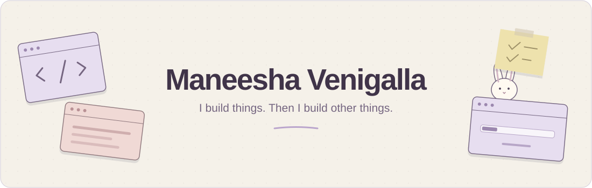

 

Web · Machine Learning · Cloud · Networking · Security

she/her · [portfolio ↗](https://www.maneeshavenigalla.com) · [projects ↗](https://github.com/Maneesha24?tab=repositories)

 

---

### About me

Always building side projects, exploring networks, and figuring out
how systems work—including the parts that would prefer I didn't.

Some work lives in private repos.
The side-project habit is public knowledge.

### What I work on

🌐 **Apps & interfaces** — useful ideas turned into working software  
🧠 **ML & cloud** — experiments, models, and the infrastructure behind them  
📡 **Networks & security** — packets, protocols, and interesting questions  

---

🐇 One more thing

 

“This should only take a weekend.”

— me, before purchasing another domain

 
Currently accepting good ideas. Already have enough of the other kind.

